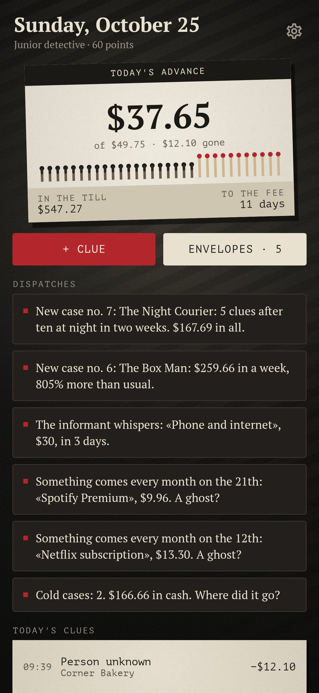
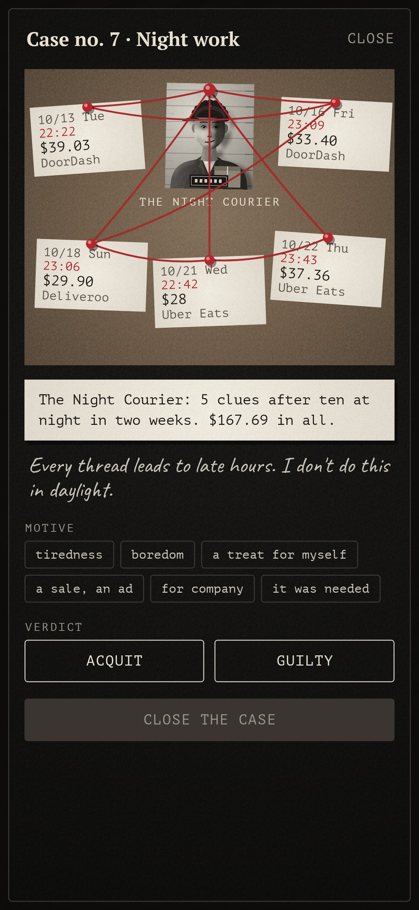
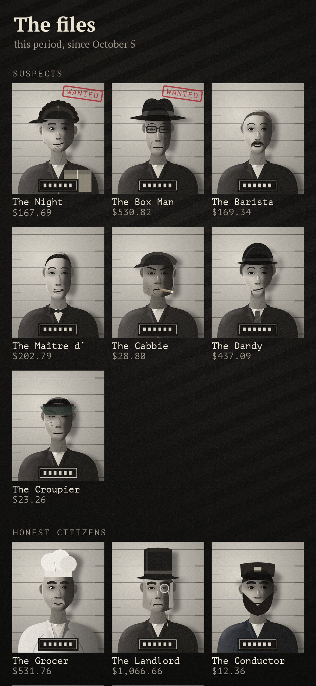
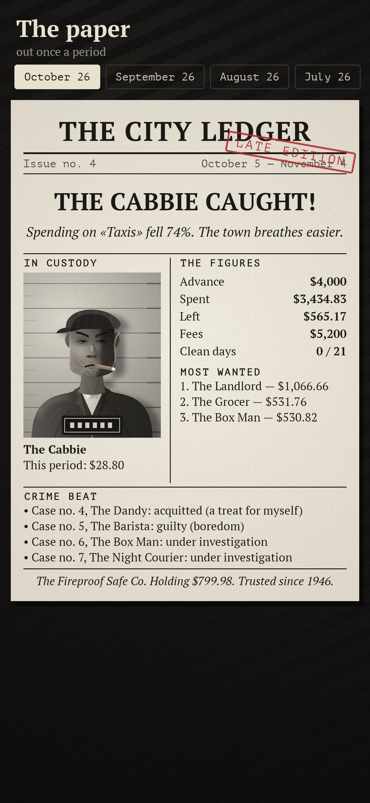
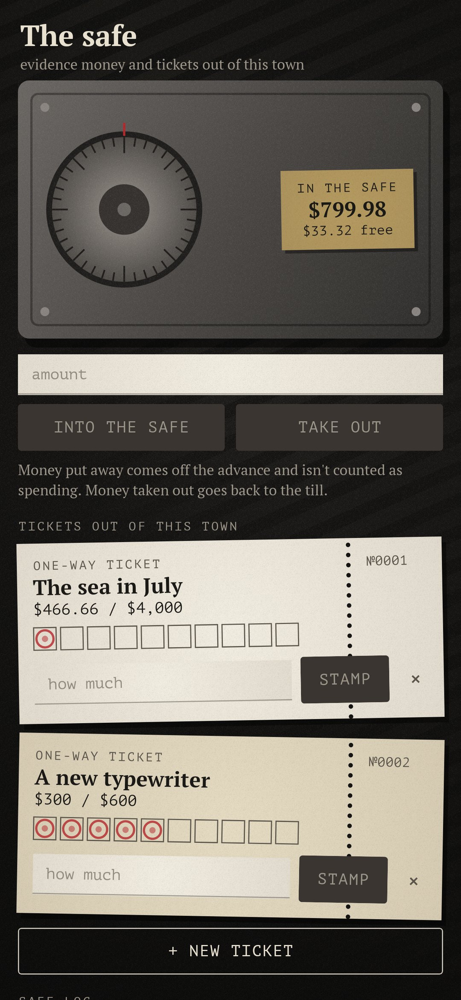

<div align="center">


# Paper Trail

### A budget kept like a detective's case file.

*It had been raining for three weeks. The money kept vanishing, not all at once but bit by bit, and the client said only: "Find out where it goes." The client was you. Spending is evidence, categories are suspects with police photos, and when the clues show a pattern a case opens: you name the motive and hand down the verdict. No shame, just detective work. Free, no ads, no account, nothing leaves the phone.*

[](https://github.com/bigdevwhale/papertrail/actions/workflows/android.yml)


[](LICENSE)

**English** · [Русский](README.ru.md) · [Changelog](CHANGELOG.md)

    

</div>

---

## How it works

1. **The client's advance.** Name a monthly sum for living and your payday. The matchbook on the desk shows what may still go today: what's left of the advance after known bills, spread over the days to the next fee. There's one match for every day of the period, and the past ones are burnt.
2. **Clues.** Every spend is a clue. Type it in, or let the **informant** read your bank's notifications on the phone and leave an envelope on the desk. A place a suspect has been to twice before sorts itself.
3. **Suspects.** Categories are faces in the files, each with a police photo drawn in code, a nickname and a way of working: the Night Courier (food delivery), the Box Man (online shops), the Barista, the Maître d', the Cabbie, the Dandy, the Croupier. Groceries, rent, the doctor and transport are *honest citizens*: watched, never prosecuted. You can add your own faces.
4. **Cases.** When the clues show a pattern, a case opens by itself. There are five patterns: night work after ten, death by small change, a sudden spree against the usual week, the same weekday every week, and a broken tail (a limit crossed). The clues hang on a cork board tied with red thread.
5. **The verdict.** Name the motive (tiredness, boredom, a treat, a sale, for company, it was needed) and acquit or find guilty. Guilty can mean just keeping an eye, a monthly tail, or a week-long ban. An acquittal counts as a solved case too.
6. **Ghosts.** Subscriptions are found by themselves: the same sum from the same place about a month apart. Exorcise one when you cancel it, and the informant tells you if it comes back.
7. **Cold cases.** Cash taken out with no trace is a cold case until you remember what it went on.
8. **The informant's whispers.** Rent, the phone and loans go on a schedule. Their sum is kept back from the daily advance, and you get a reminder five days ahead.
9. **The safe and tickets out of town.** Put leftover money in the safe. A ticket is a savings goal with ten stamp boxes, filled from the safe.
10. **The paper.** Each period gets a front page of *The City Ledger*: who was caught and who's at large, the figures, the crime beat and the ghosts in town.
11. **The evening report.** At nine a typed line from the detective's diary sums up the day. The rank grows with cases closed and cold cases solved, never with spending less.

## Build

```
./gradlew testDebugUnitTest assembleDebug
./gradlew -Pdemo assembleDebug          # app.papertrail.demo with three months of clues, cases and files
./gradlew testDebugUnitTest -Prender --tests '*RenderArt*'   # every screen, the faces and docs/logo.png to app/build/art
python tools/shots.py app/build/art     # README screenshots from the renders
```

How it's built:
- Everything is drawn in code. The police photos are layered paths with soft light in `ui/art/Mugshot.kt`; the grain, blinds, cork and threads live in `ui/components`.
- The case patterns are in `domain/Detective.kt`, the daily advance in `domain/Ledger.kt`, and the notification reader with its tests in `domain/Notice.kt`.
- The evening report lines are in `app/src/main/assets/lines.tsv`. Sounds are synthesised on first launch.

Fonts: [PT Serif and PT Mono](https://fonts.google.com/?query=PT) and [Caveat](https://fonts.google.com/specimen/Caveat), SIL Open Font License.
