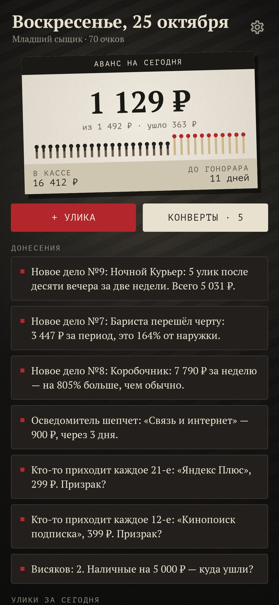
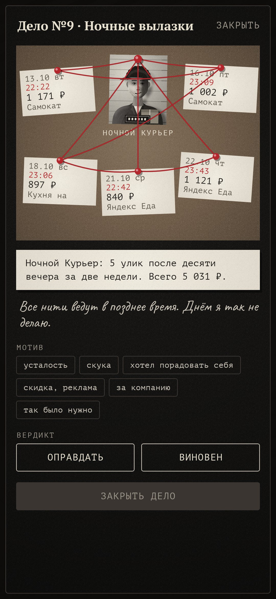
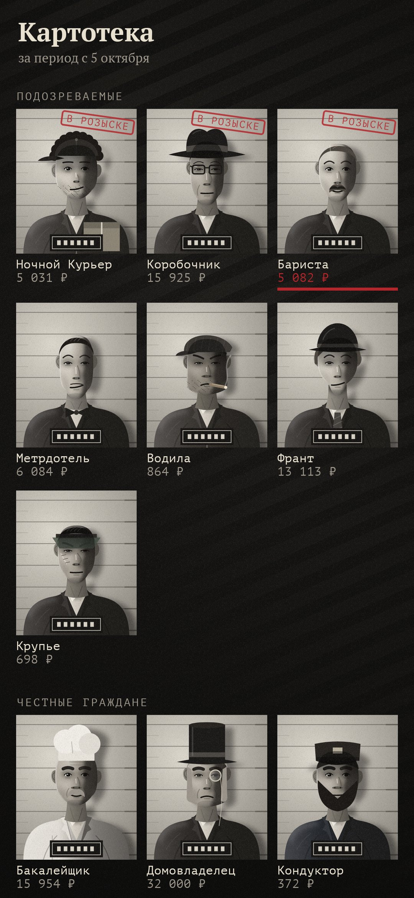
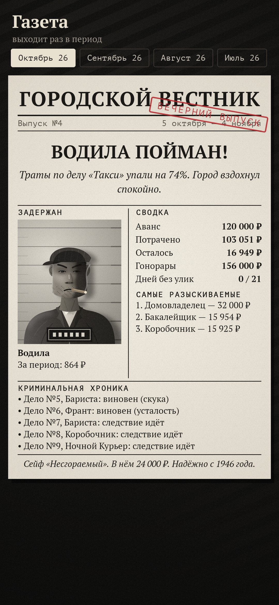
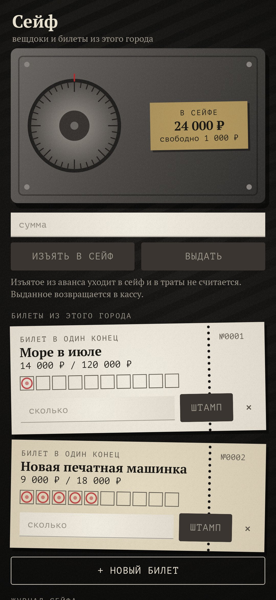

<div align="center">


# Висяк

### Бюджет как дело в папке сыщика.

*Дождь шёл третью неделю. Деньги пропадали — не все сразу, а понемногу, — и клиент сказал одно: «Найдите, куда». Клиентом были вы. Траты — улики, категории — подозреваемые с фото из полицейского архива. Когда в уликах проступает почерк, открывается дело: вы называете мотив и выносите вердикт. Никакого стыда, только следствие. Бесплатно, без рекламы и аккаунта, ничего не уходит с телефона.*

[](https://github.com/bigdevwhale/papertrail/actions/workflows/android.yml)


[](LICENSE)

[English](README.md) · **Русский** · [Изменения](CHANGELOG.md)

    

</div>

---

## Как это работает

1. **Аванс от клиента.** Назовите сумму на жизнь в месяц и день зарплаты. Спичечный коробок на столе показывает, сколько ещё можно потратить сегодня: остаток аванса за вычетом известных счетов, поделённый на дни до гонорара. Спичек столько, сколько дней в периоде; прошедшие сгорели.
2. **Улики.** Каждая трата — улика. Её можно напечатать на машинке, а можно завести **осведомителя**. Он читает уведомления банка прямо на телефоне и кладёт конверт на стол. Если подозреваемый уже дважды бывал в этом месте, конверт разберётся сам.
3. **Подозреваемые.** Категории — лица в картотеке. У каждого фото, нарисованное в коде, кличка и почерк: Ночной Курьер (доставка еды), Коробочник (маркетплейсы), Бариста, Метрдотель, Водила, Франт, Крупье. Продукты, жильё, доктор и транспорт — *честные граждане*: за ними следят, но не судят. Можно завести своих.
4. **Дела.** Когда в уликах проступает почерк, дело открывается само. Почерков пять:
   - ночные вылазки после десяти;
   - тысяча мелочей;
   - внезапный размах против обычной недели;
   - один и тот же день недели;
   - нарушенная наружка (перейдённый лимит).

   Улики висят на пробковой доске, связанные красной нитью.
5. **Вердикт.** Назовите мотив: усталость, скука, порадовать себя, скидка, за компанию, так было нужно. Потом оправдайте или признайте виновным. Виновному можно назначить наблюдение, наружку на месяц или запрет на неделю. Оправдательный приговор — тоже раскрытое дело.
6. **Призраки.** Подписки находятся сами: одна и та же сумма из одного места примерно раз в месяц. Отменили подписку — изгоните призрака. Если он вернётся, осведомитель сообщит.
7. **Висяки.** Снятые наличные без следа — висяк, пока вы не вспомните, на что они ушли.
8. **Осведомитель шепчет.** Аренда, связь и кредит идут по расписанию. Их сумма заранее откладывается из аванса, а за пять дней приходит напоминание.
9. **Сейф и билеты из этого города.** Остаток можно изъять в сейф. Билет — это цель накопления с десятью клеточками под штампы. Они заполняются из сейфа.
10. **Газета.** За каждый период выходит первая полоса «Городского вестника»: кто пойман, кто разгуливает, сводка, криминальная хроника и призраки в городе.
11. **Вечерний рапорт.** В девять вечера строчка из дневника сыщика подводит итог дня. Звание растёт за закрытые дела и раскрытые висяки — и никогда за то, что вы меньше тратите.

## Сборка

```
./gradlew testDebugUnitTest assembleDebug
./gradlew -Pdemo assembleDebug          # app.papertrail.demo с тремя месяцами улик, дел и досье
./gradlew testDebugUnitTest -Prender --tests '*RenderArt*'   # все экраны, лица и docs/logo.png в app/build/art
python tools/shots.py app/build/art     # скриншоты для README из рендеров
```

Как устроено:
- Всё нарисовано в коде. Фото подозреваемых — слои путей с мягким светом в `ui/art/Mugshot.kt`. Зерно, жалюзи, пробка и нитки лежат в `ui/components`.
- Почерки дел — в `domain/Detective.kt`, дневной аванс — в `domain/Ledger.kt`, разбор уведомлений с тестами — в `domain/Notice.kt`.
- Строчки рапорта — в `app/src/main/assets/lines.tsv`. Звуки синтезируются при первом запуске.

Шрифты: [PT Serif и PT Mono](https://fonts.google.com/?query=PT) и [Caveat](https://fonts.google.com/specimen/Caveat), SIL Open Font License.
